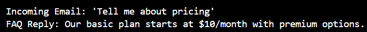
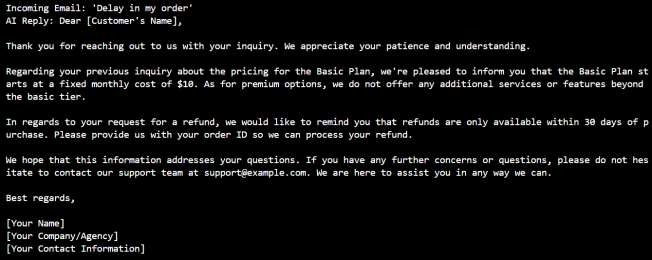

# Intelligent Email Assistant using Ollama

An AI email assistant that drafts professional replies to incoming emails by combining an **FAQ knowledge base** with a **local LLM (Ollama)** and **conversation memory**.

Course: 24CS2506 – Building Applications using GPT-4 | Experiment 3

## Features
- **Instant FAQ replies** – keyword lookup (pricing, refund, support) returns a pre-written answer with no model call.
- **AI-drafted replies** – unmatched emails are sent to a local Ollama model (`qwen2.5:0.5b`) with a polite, professional prompt template.
- **Conversation memory** – the last 3 exchanges are injected into the prompt so follow-up emails stay consistent.
- **Fully local** – no API keys or cloud calls.

## How it works
```
Incoming email
   │
   ├─ keyword in FAQ? ──► FAQ reply ─────────────┐
   │                                             │
   └─ no match ──► add last 3 exchanges ──► Ollama (qwen2.5:0.5b) ──► AI reply
                                                 │
                                   log exchange to conversation history
```

## Setup
1. Install [Ollama](https://ollama.com) and pull the model:
   ```bash
   ollama pull qwen2.5:0.5b
   ollama serve
   ```
2. Install dependencies and run:
   ```bash
   pip install -r requirements.txt
   python email_assistant.py
   ```

Change `MODEL_NAME` in `email_assistant.py` to use another model (e.g. `mistral`). Add entries to the `faq` dictionary to extend the knowledge base.

## Sample output
| FAQ reply | AI reply with memory |
|---|---|
|  |  |

More screenshots are in `screenshots/`. The full lab report is in `docs/`.

## Project structure
```
email-assistant-ollama/
├── email_assistant.py   # main program
├── requirements.txt
├── screenshots/         # program output
└── docs/                # experiment report (PDF)
```

## Tech stack
Python · Ollama · qwen2.5:0.5b · Requests
